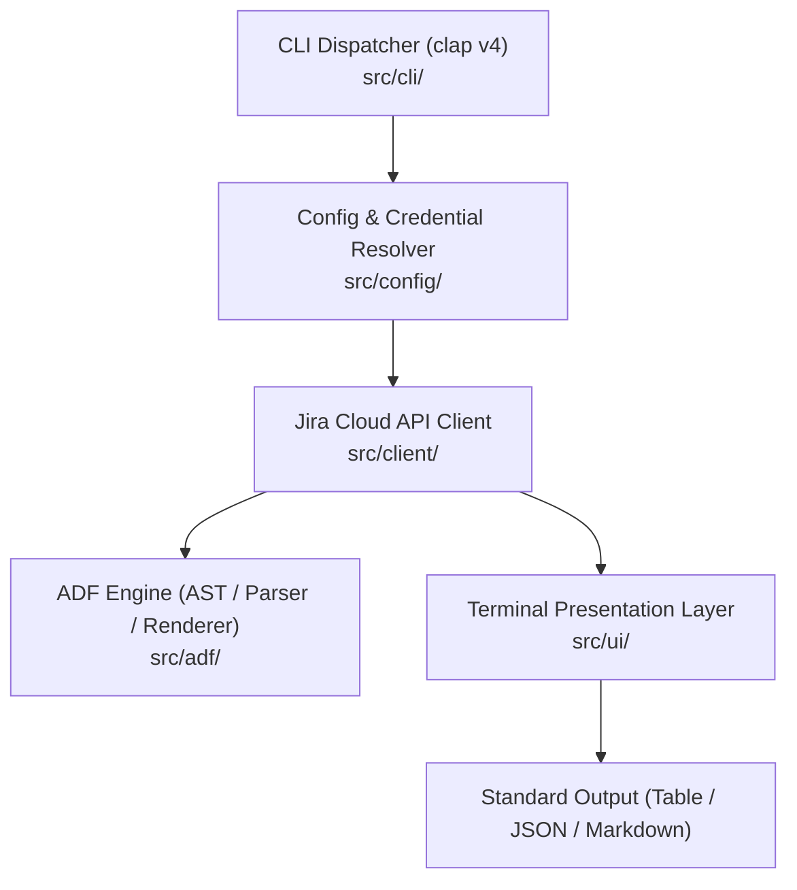

# `jira-cli` Technical Architecture Specification

This document details the internal design, component relationships, data flow, and implementation patterns of `jira-cli`.

---

## 1. System Overview

`jira-cli` is architected as a modular Rust application designed for high performance, terminal ergonomics, and robust Atlassian Cloud REST API v3 integration.



---

## 2. Core Modules

### 2.1 ADF (Atlassian Document Format) Engine (`src/adf/`)
Jira Cloud Platform REST API v3 mandates ADF (a JSON Abstract Syntax Tree) for all rich text fields (`description`, `comment`, multi-line custom fields).

- **AST Representation (`src/adf/ast.rs`):**
  - Models `DocNode`, `Node`, `Mark`, and attribute structures with full `serde` serialization.
  - Supports standard block elements (`paragraph`, `heading`, `bulletList`, `orderedList`, `listItem`, `codeBlock`, `blockquote`, `panel`, `rule`).
  - Supports inline formatting marks (`strong`, `em`, `code`, `strike`, `link`, `underline`).
- **Markdown-to-ADF Compiler (`src/adf/from_text.rs`):**
  - Compiles standard Markdown into Jira v3 ADF JSON AST on the fly.
  - Supports headings (`#`), lists (`- `, `1. `), code fences (````), blockquotes (`> `), horizontal rules (`---`), and inline links/marks.
- **Terminal ADF Renderer (`src/adf/to_terminal.rs`):**
  - Traverses the ADF AST to format rich text in the terminal.
  - Supports both colorized ANSI output and clean plain Markdown output for piping.

### 2.2 Jira REST API v3 Client (`src/client/`)
An asynchronous client utilizing `reqwest` and `tokio`:
- **Authentication (`src/client/auth.rs`):** Generates `Authorization: Basic <base64(email:token)>` headers and injects identifying `User-Agent` metadata.
- **Middleware & Error Handling (`src/client/middleware.rs`):**
  - Intercepts HTTP 429 Too Many Requests and reads the `Retry-After` header.
  - Deserializes Jira's structured `errorMessages` and `errors` maps into typed `JiraError::Api` variants.
- **Issue Operations (`src/client/issue.rs`):** Full CRUD operations (including permanent deletion with subtasks), JQL queries, workflow transitions, comments, worklogs, multipart file attachments, bidirectional issue links, watcher management, and changelog history.
- **Agile & Project APIs (`src/client/sprint.rs`, `src/client/project.rs`):** Boards, sprints, project metadata, release version lifecycle, and project components.

### 2.3 Configuration & Resolver (`src/config/`)
- Stored at `~/.config/jira-cli/config.json` (or custom `--config` path).
- Enforces strict Unix file permissions (`0600`) upon write to protect sensitive API tokens.
- **Precedence Hierarchy:**
  1. CLI Flags (`--instance`, `--email`, `--token`, `--project`, `--profile`)
  2. Environment Variables (`JIRA_INSTANCE_URL`, `JIRA_USER_EMAIL`, `JIRA_API_TOKEN`, `JIRA_DEFAULT_PROJECT`, `JIRA_PROFILE`)
  3. Configuration File Profiles (`profiles.<name>`)

### 2.4 Presentation Layer (`src/ui/`)
- Default table formatting uses `comfy-table`.
- **Zero Raw ANSI In Cells:** To ensure precise column width calculation and prevent border misalignment, styles and colors are applied strictly via `Cell::fg(Color::...)` and `Attribute::Bold`.
- Machine-readable JSON output (`--output json`) directly exposes API payloads for `jq` and Unix tool composition.

---

## 3. Testing Strategy

The test suite covers unit and end-to-end integration flows:
1. **Unit Tests:** Serialization roundtrips, ADF parsing, table builders, and error formatting.
2. **CLI Smoke Tests (`tests/cli_tests.rs`):** Verifies `--version` and `--help` repository attribution, shell completions (`bash`, `zsh`), and missing credential failures using `assert_cmd`.
3. **Configuration Tests (`tests/config_tests.rs`):** Tests configuration precedence with a mutex-guarded `ENV_LOCK` (`EnvGuard`) to prevent environment variable race conditions during concurrent test execution.
4. **Mock HTTP Server Tests (`tests/mock_api_tests.rs`):** Uses `wiremock` to spin up local async mock servers validating Jira v3 endpoints, rate-limit backoff, and error response bodies offline.

---

## 4. Documentation Standards

- All modules contain `//!` module-level docstrings.
- All public and internal structs, enums, fields, and methods contain `///` docstrings.
- Verified without warnings using:
  ```bash
  RUSTDOCFLAGS="-D warnings" cargo doc --no-deps
  ```
